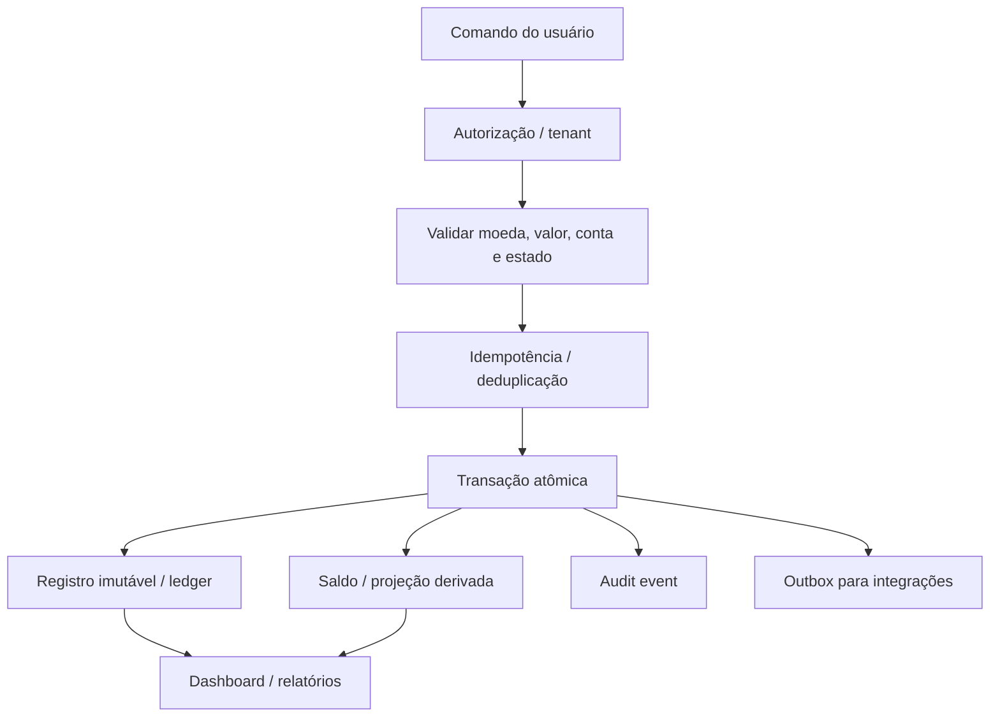

# Modelo conceitual — fluxo de registro financeiro

Diagrama conceitual. Verificar se o código atual usa ledger imutável, projeções, audit event e outbox; não inferir implementação a partir desta representação.

## Regras de qualidade do domínio

- Valores exatos: Decimal/Numeric ou integer minor units com moeda e política de arredondamento documentada.
- Toda mutação financeira deve ser autorizada, atômica, idempotente e rastreável.
- Correções: reversão ou compensação auditável, não apagar histórico silenciosamente.
- Não misturar transações reais, estimativas, projeções e simulações.
- Transferências internas não representam receita/despesa consolidada.
- Validar consistência entre ledger, saldos e relatórios.