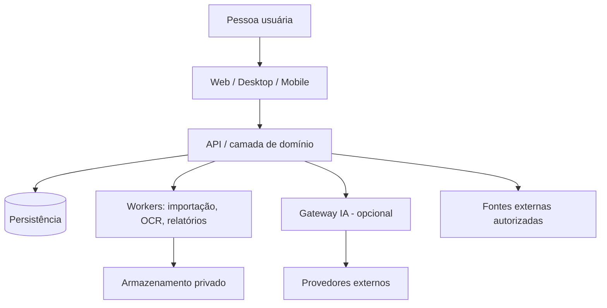
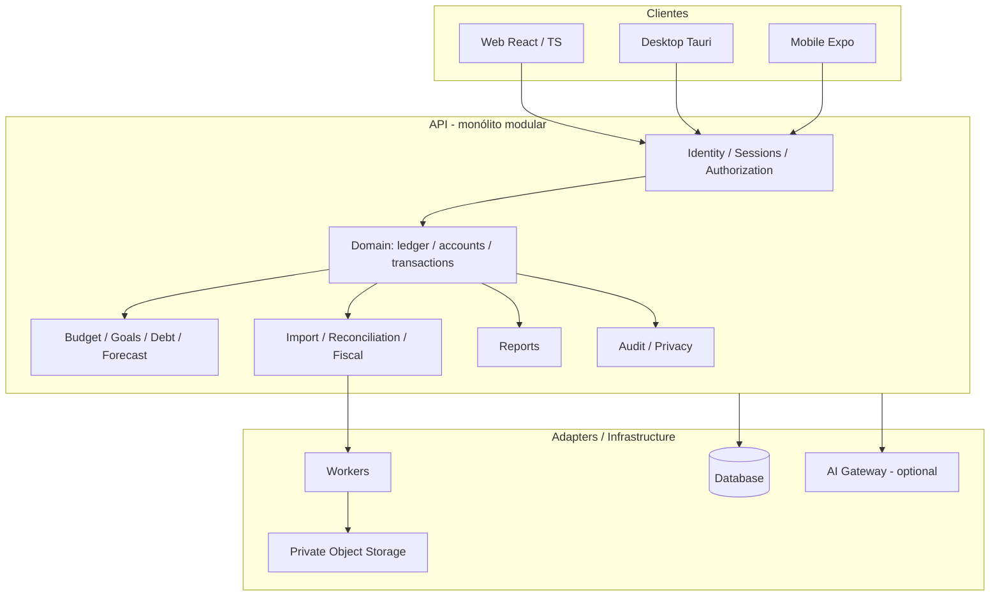
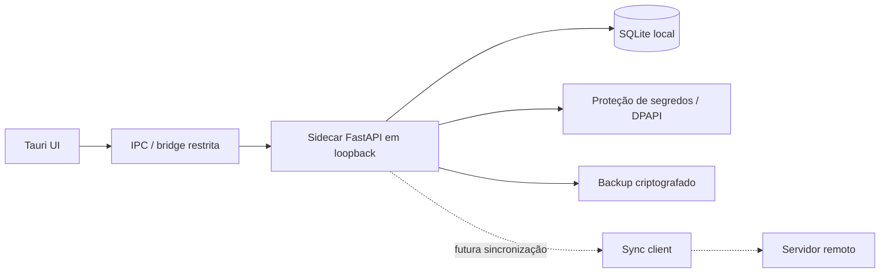
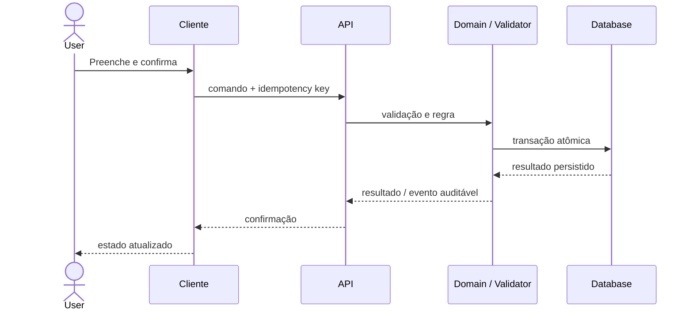
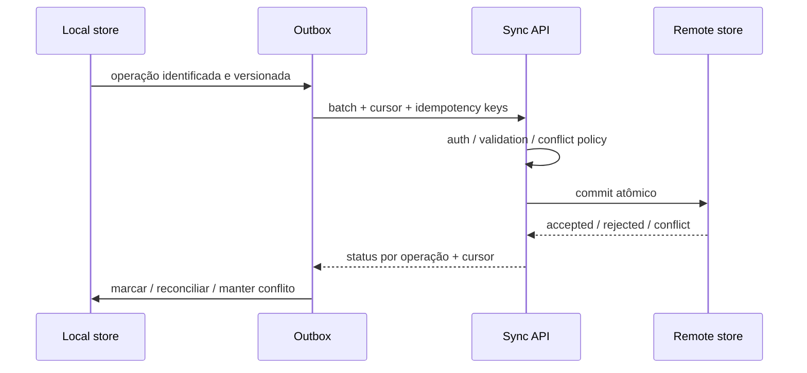
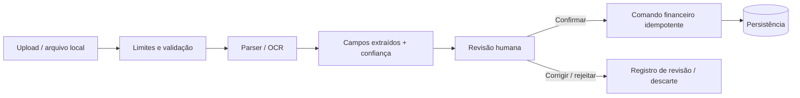

# Diagramas de Arquitetura SFI

Diagramas vivos: manter alinhados com ADRs, código, schema e release. Diagramas descrevem arquitetura **proposta/observada** e não certificam implementações.

## 1. Contexto do sistema

**Status:** abstração conceitual. Persistência, runtime e plataformas ainda precisam de decisão arquitetural consolidada (ADR pendente).

## 2. Arquitetura de referência em camadas

**Boundary:** clientes não acessam diretamente banco, segredo de servidor ou fornecedor de IA. Toda mutação passa por validação, autorização e domínio; ações persistentes/extraídas exigem revisão humana quando aplicável.

## 3. Runtime desktop local-first (PR #17; proposta de branch, não integrada em main)

**Status:** arquitetura descrita no PR #17. Não tratar como arquitetura aprovada até decisão explícita e inspeção/revisão do PR.

## 4. Fluxo financeiro (lançamento confirmado)

**Garantias a exigir nos testes:** atomicidade, idempotência, Decimal, autorização, controle de concorrência, auditabilidade, sem double-posting.

## 5. Sincronização futura

**Não implementado como protocolo completo:** diagrama de destino; conflitos financeiros não podem usar sobrescrita silenciosa.

## 6. Fluxo de documento fiscal

**Segurança:** parser isolado, limites, tratamento de arquivos hostis, minimização e autorização por usuário.

## 7. Matriz de status dos diagramas

| Diagrama | Estado |
|---|---|
| Contexto | Conceitual |
| Camadas | Referência |
| Runtime desktop local-first | Proposta no PR #17 |
| Lançamento financeiro | Fluxo alvo; verificar implementação |
| Sync | Futuro / não comprovado |
| Documento fiscal | Fluxo alvo; verificar implementação |

Atualizar estes diagramas no mesmo PR que alterar boundaries, protocolo, schema ou runtime.